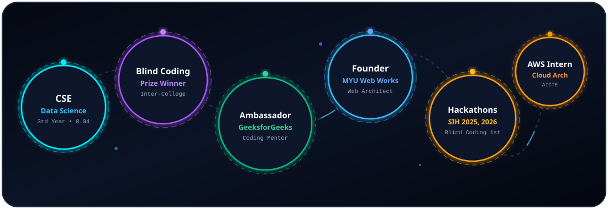
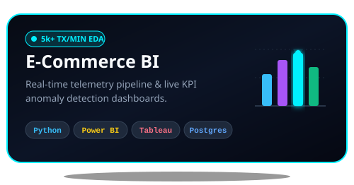
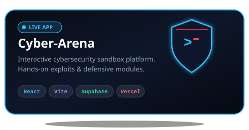
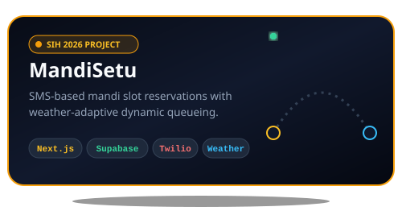
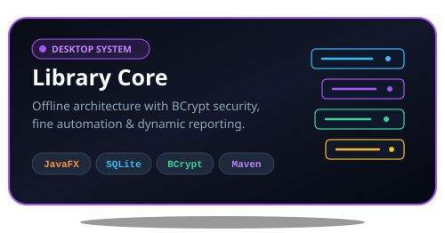
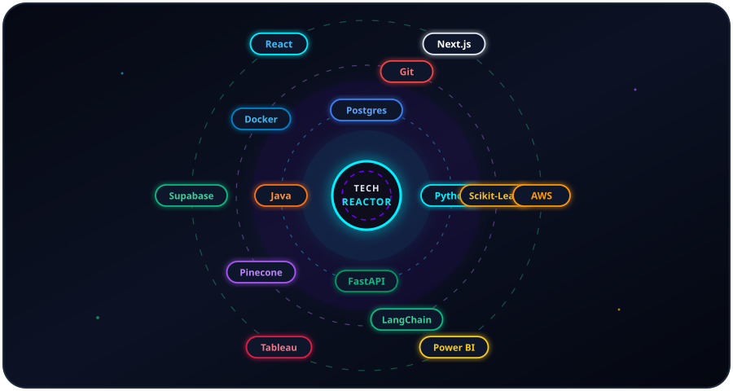

<div align="center">

<!-- CYBER NEON HEADER BANNER -->


<br/>

<!-- REAL-TIME TYPING TELEMETRY -->
<a href="https://github.com/im-yousuf">
  
</a>

<br/><br/>

<!-- INTERACTIVE CONNECT BADGES -->
<p align="center">
  <a href="https://linkedin.com/in/mohammed-yousuf-uddin" target="_blank">
    
  </a>
  <a href="mailto:yousufuddin.146@gmail.com">
    
  </a>
  <a href="https://github.com/im-yousuf">
    
  </a>
  <a href="https://cyberarena-1.vercel.app" target="_blank">
    
  </a>
</p>

<!-- QUICK HUD PILLS -->
<p align="center">
  
  
  
  
  
  
</p>

</div>

---

## 💻 Terminal Session

<div align="center">
  
</div>

---

## 🌐 Neural Quantum Network

<p align="center">
  <i>Orbiting roles, leadership initiatives, and technical milestones.</i>
</p>

<div align="center">
  
</div>

---

## 🚀 Featured Deployments & Projects

<table align="center" width="100%">
  <tr>
    <td align="center" width="50%">
      <a href="https://github.com/im-yousuf?tab=repositories">
        
      </a>
    </td>
    <td align="center" width="50%">
      <a href="https://cyberarena-1.vercel.app" target="_blank">
        
      </a>
    </td>
  </tr>
  <tr>
    <td align="center" width="50%">
      <a href="https://github.com/im-yousuf?tab=repositories">
        
      </a>
    </td>
    <td align="center" width="50%">
      <a href="https://github.com/im-yousuf?tab=repositories">
        
      </a>
    </td>
  </tr>
</table>

---

## ⚛️ Tech Reactor & Gravitational Orbit

<p align="center">
  <i>Technologies, frameworks, databases, and cloud systems orbiting my core stack.</i>
</p>

<div align="center">
  
</div>

<br/>

<div align="center">

| Domain | Core Weaponry |
| :--- | :--- |
| **🧠 Data Science & ML** | `Python` `NumPy` `Pandas` `Matplotlib` `Seaborn` `Scikit-Learn` `Predictive Modeling` `EDA` |
| **🤖 AI & LLM Systems** | `Generative AI` `LangChain` `Pinecone (Vector DB)` `Deep Learning Fundamentals` `RAG Workflows` |
| **⚡ Backend & APIs** | `FastAPI` `RESTful APIs` `Java` `Maven` `BCrypt` `JavaFX` `SQLite` |
| **🗄️ Databases & Cloud** | `PostgreSQL` `MySQL` `Supabase` `AWS (EC2, S3, IAM)` `Docker` `Snowflake / MongoDB (Prep)` |
| **📊 BI & Analytics** | `Power BI` `Tableau` `Advanced SQL` `Anomaly Detection` `Excel Data Modeling` |

</div>

---

## 💼 Experience & Leadership Matrix

```
🏢 GeeksforGeeks                                                  [Jul 2026 – Present]
   Role: Campus Ambassador | Hyderabad, India
   ▸ Spearheaded technical initiatives, coding competitions, and hack workshops across campus.
   ▸ Fostered a thriving developer culture in Data Structures, Algorithms, & System Design.
   ▸ Acted as primary liaison between student developers and GeeksforGeeks technical network.

☁️ Amazon Web Services (AWS) via AICTE                            [Oct 2025 – Nov 2025]
   Role: Cloud Foundations Virtual Intern | Remote
   ▸ Gained deep architectural proficiency in AWS cloud services (EC2, S3, IAM, Cloud Deployments).
   ▸ Architected scalable infrastructure aligned with modern enterprise data engineering practices.
```

---

## 🏆 Honors, Awards & Credentials

- 💡 **Smart India Hackathon (SIH)**: Selected Participant (2025, 2026 Editions).
- 🥇 **Inter-College Blind Coding**: Consolation Prize Winner for pure algorithmic speed & syntax mastery.
- 📜 **AICTE AWS Cloud Foundations**: Certified (2025).
- 🎯 **Upcoming Credentials**: MongoDB & Snowflake Specialist (Expected 2026).

---

## 📊 Live GitHub Telemetry

<div align="center">
  <table border="0">
    <tr>
      <td>
        
      </td>
      <td>
        
      </td>
    </tr>
  </table>

  <br/>

  
</div>

---

## 🐍 Contribution Stream

<div align="center">
  
</div>

<p align="center">
  <i>Every commit fuels the neural grid. Keep coding daily! ⚡</i>
</p>

---

## 🤝 Let's Connect & Collaborate!

<div align="center">

Whether you're looking to build an AI/ML application, collaborate on an open-source project, or discuss high-performance data systems—my inbox is always open!

<br/>

<a href="mailto:yousufuddin.146@gmail.com">
  
</a>
<a href="https://linkedin.com/in/mohammed-yousuf-uddin" target="_blank">
  
</a>
<a href="https://github.com/im-yousuf" target="_blank">
  
</a>

<br/><br/>

<!-- DYNAMIC DEV QUOTE -->


<br/><br/>

<!-- ANIMATED CYBER FOOTER -->


<p align="center">
  <i>⚡ Engineered with passion, precision &amp; pixels by <b>Mohammed Yousuf Uddin</b> ⚡</i>
</p>

</div>
